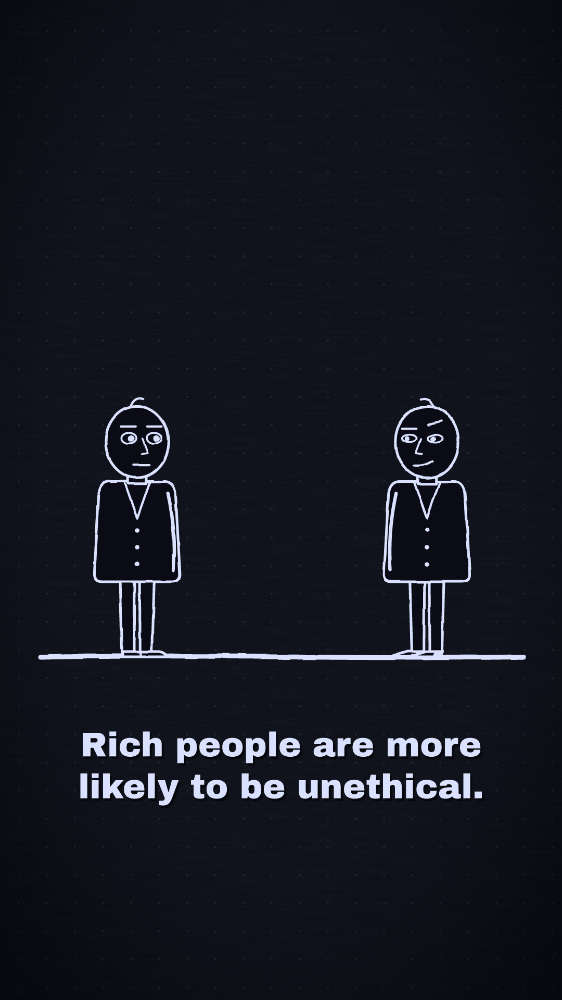
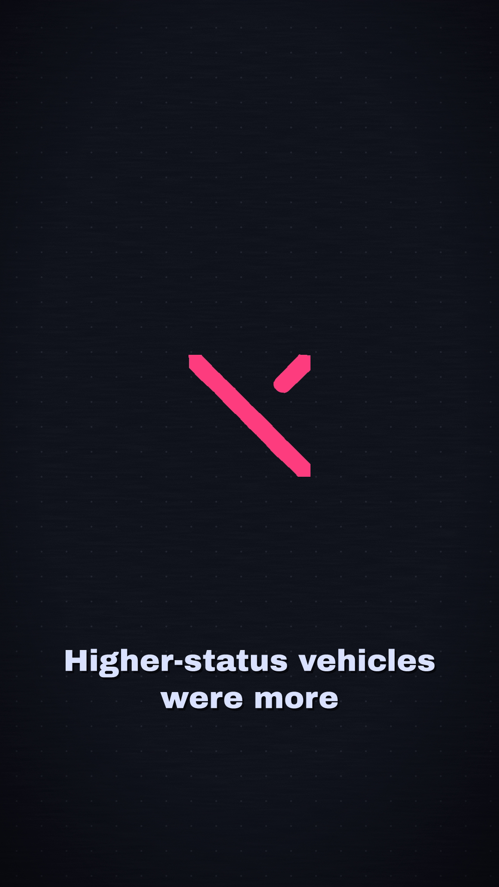
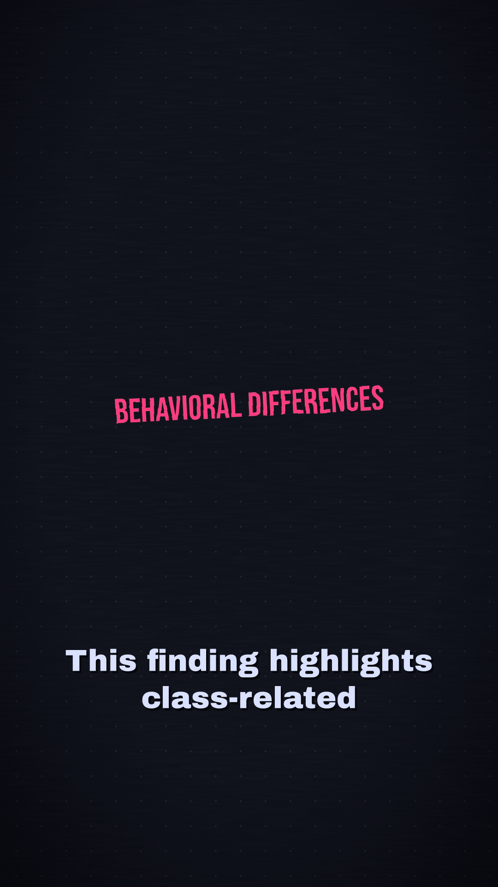
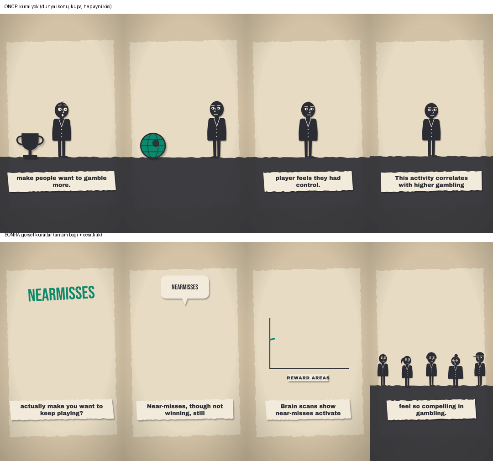
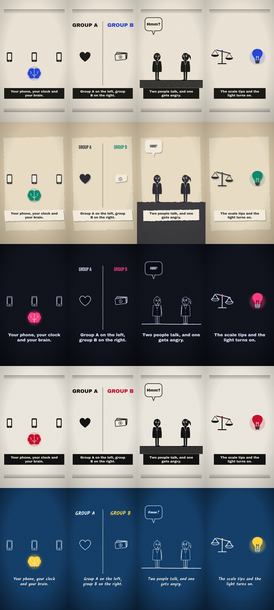

# ytfactory: from a topic to a finished video, on my own computer

*Türkçe: [README.md](README.md)*

I have been editing video since 2021. I wanted to make short videos about psychology and behavioral science, but editing each one by hand took hours. I had tried an automated YouTube pipeline before and it did not work out. This time I built this: I type a topic, and the agent finds a source, writes the script, **checks it against the source**, draws the scenes, adds a voice-over and renders the video. Everything runs on my own computer, and it never uploads anything by itself. I decide what gets published.

## The panel: type a topic, get a video
I made a panel (`panel.py`) so that someone who does not code can use it too:
1. Write one or two sentences in the **Topic** box (Turkish is fine). A local model turns it into an English search query. The panel brings 4 papers from PubMed and 2 Wikipedia articles.
2. Pick a source; the abstract and the citation fill in automatically. If you know the paper's number, you can also load it directly by PubMed ID.
3. Choose the style, the language and how much to produce: only the script, a few frames, or the full video. While the agent works, its steps stream live: how many tries it took, what the checker caught, what got repaired.
4. The **Gallery** tab shows the video, script, source and the agent's log side by side.

```bash
pip install streamlit
streamlit run panel.py
```

## What happens inside

```
source → [7B] script → number check + [14B] fact check → [7B] scene recipe → word-anchor and style check
       → voice-over + word timings → check frames → MP4
```

- **One model writes the script; a different, bigger model checks it.** Every number in the script must appear in the source, or it goes back. Then a 14B checker compares each sentence with the source, looking for things like a rate assigned to the wrong group or a generalization the source never makes.
- **The model does not write code; it writes a recipe.** A small model cannot reliably write animation code. So I gave the agent a limited "drawing vocabulary" (title, person, counter, chart, objects…) and it only writes "what should be on screen in each scene". My own code (`src/render/spec.js`) turns that recipe into the real scene. Layout and timing live in code, so the model cannot push things off screen or break the style.
- **Images are tied to words.** Animations start on the spoken word, not on a timer. The car appears the moment the word "car" is said, so sound and picture always stay in sync.
- **Every check sends the error back to the model.** It retries up to 3 times. Some errors are repaired by code instead of the model. Every step is written to `ajan_kaydi.json`.

```bash
python src/ajan.py --slug 920-example --kaynak source.txt --atif "Author (year), Journal" --stil neon --sadece video
```

One video takes about 12-27 minutes on this computer (GTX 1650, 4 GB).

## Product ads: from a photo to a video
Give the agent a product photo and it cuts the product out and places it inside the line animation:
- **Cutout** (`src/urun.py`): removes the background with a local model (rembg), trims empty edges and writes a transparent PNG. If the photo also shows legs or hands, `--kutu x1,y1,x2,y2` points it at the product; the automatic cutter takes the most prominent object but doesn't know which one is the product.
- **In the scene** there is a new `photo` element: the product slides in, floats, spins or pops up, still tied to a spoken word.
- **Ad mode** (`--kip reklam`): writes a 5-6 line ad script. The source text is the product description; inventing prices, discounts, materials or delivery promises is forbidden, and the checker model enforces it.
- **The panel** has an "Add product photo" section and a "Product ad" option.

```bash
python src/urun.py photo.jpg product.png --kutu 140,270,580,640
python src/ajan.py --slug 960-boot --kaynak product_description.txt --atif "Brand" --kip reklam --urun photo.jpg --stil gece
```

## Examples
| Video | Source | Style | What happened |
|---|---|---|---|
| [900 Status and ethics](videos/900-ajan-test) | Piff et al. 2012, *PNAS* | neon | First test; most of the errors below were found here |
| 910 Near-misses (gambling) | Clark et al. 2009, *Neuron* | kesik | Came out on the 4th try (27 min); four different failures fixed one by one |
| 911 Talking on the phone while driving | Strayer et al. 2003, *J Exp Psychol Appl* | plan | The checker caught "impairs vision"; it should be "attention" |
| 912 Taking notes by hand vs. laptop | Mueller & Oppenheimer 2014, *Psychol Sci* | lino | Produced with 3 automatic repairs |

<p>



</p>

## What broke, and how I fixed it

**1. Right number, wrong meaning: the most dangerous one.** The model wrote "34.9% of luxury cars did not yield". In the source, 34.9% is the rate for *all* drivers. Because the number does appear in the source, my number check could not see the problem. I made the same 7B model the checker, and it missed it too. When I made the checker a separate, bigger model (14B), it caught the error with the right reason: "This rate is for all vehicles, not the subgroup." It also flagged a generalization that was not in the source.

| | 7B checks itself | 7B writer + 14B checker |
|---|---|---|
| Made-up number | caught (rule) | caught (rule) |
| Rate assigned to the wrong group | **passed** | **caught** |
| Generalization not in the source | passed | caught |

**2. The model was stubborn, so code repaired it.** In the scene recipe, the model tied animations to word groups like "were observed". The check caught it, but the model failed to fix it in 3 tries. I did two things: I put the list of allowed words for each line into the prompt, and I wrote a repair step that picks the first word of the group that appears in the line. In the same way, when it asks for objects that are not in the library ("billboard", "slot"), they now become a title that shows that word on screen, so the meaning is kept. The same logic now repairs two more stubborn errors: if a scene uses more than two highlights, the extras are toned down; if the model writes no scene for a line, a title scene with that line's key word is added. I caught both while running the video agent under [Nöbetçi](https://github.com/emirhnnnk-lab/nobetci).

**3. Some errors are only caught by a human eye.** The first video's frames had a number that wasn't in the source and a wrongly split subtitle; none of them were caught by the automatic checks. That's why I added the check-frames step; a human looks before anything is published.

**4. The checker is inconsistent too.** In one video it missed an overgeneralization; in another it rejected a correct sentence that was word for word in the source. As a last resort I added this: if lines are still flagged on the final try, they are removed, as long as at least 5 lines remain. Dropping a suspicious sentence is safer than keeping it.

**5. Rules stopped bad images but did not create good ones.** I added rules like "don't pick images unrelated to the line", "don't repeat the same image back to back" and "don't leave the screen empty at the start of a line". The wrong images went away (like the globe icon in the gambling scene). But the model then escaped into text: scenes got emptier, a chart appeared with no data, and "near-misses" was written without the hyphen. I also tried letting a small vision model (SmolVLM-500M) check the frames; it called the globe icon an "eyeball". A model that size cannot do this job.



### Problems still left (kept in the log)
- 900 says "rich people behave more unethically". The study only showed this in traffic; it is an overgeneralization and the checker let it through.
- 911 says "they failed to notice the brake lights". The source says "their reactions were impaired".
- 912 says "worse on tests"; the source says "on conceptual questions". The claim "it hurts memory" is not in the abstract either.
- Later replications of Mueller & Oppenheimer gave mixed results. The agent only sees the abstract, so it cannot know this.

In all three videos the checker let at least one overgeneralization through. To be honest, **this agent is not ready to publish without a human check**, so the publishing decision stays with me.

## Drawing vocabulary and styles
The first version had 9 elements, and for topics like sleep, attention or money the agent could not find the right image and fell back to text. Now there are 14 scene elements and 20 objects:
- **Scene elements:** title, stamp, label, person, walking person, row, counter, cross, speech bubble, icon, chart (rising / falling / bars), split comparison, two people facing each other, crowd
- **Objects:** car, money, house, book, gift, phone, clock, brain, heart, light bulb, lock, trophy, scale, globe, banknote, pill, bed, laptop, pen, eye

Scene code never picks colors or fonts; it only asks the style (`src/render/styles.js`). That is why every object looks right in all 6 styles without extra tuning: `gece`, `lino`, `kesik`, `neon`, `gazete`, `plan`.



## Channels
| Channel | Format | Language | Style |
|---|---|---|---|
| Mind After Dark | Shorts + long | EN | gece |
| Beyin Kesiti | Shorts | TR | kesik |
| The Status Engine | Long | EN | lino |

Channel graphics (banner, avatar) are also made with code: `node channels/brand.js`.

## Tech
Python · Ollama (qwen2.5 7B + 14B, local) · Node.js · resvg-js (SVG → PNG) · edge-tts · ffmpeg · Streamlit

## Running it by hand
```bash
npm install
python src/tts.py videos/004-crosswalk/script.en.json
node src/render/render.js videos/004-crosswalk gece en video
```

---
Built by **Emirhan Karaca**
