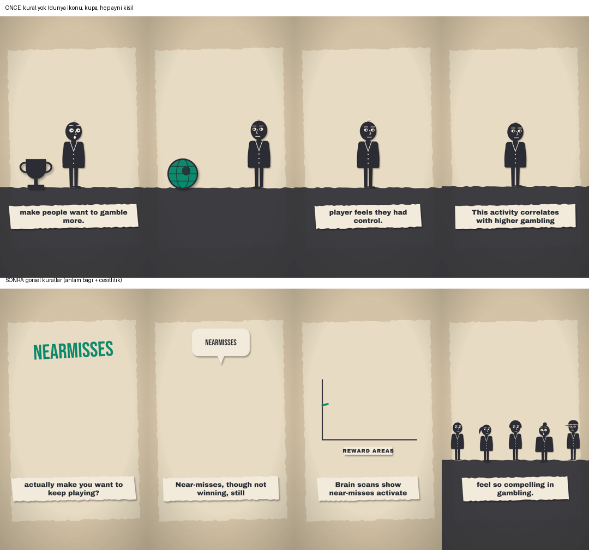

# ytfactory: konudan bitmiş videoya, kendi bilgisayarımda

> **EN summary:** An agent that turns a topic or a research abstract into a finished animated short video, fully local: a 7B writer drafts the script, a separate 14B fact-checker verifies every claim against the source, a validator/repair loop builds the scene spec, then TTS with word-level timing and SVG rendering produce the MP4. Includes a Streamlit panel (type a topic → pick a source from PubMed/Wikipedia → get a video) and a documented error→fix history. Nothing is uploaded automatically. Full English version: [README.en.md](README.en.md).

2021'den beri video kurguluyorum. Psikoloji ve davranış bilimi üzerine kısa videolar yapmak istedim, ama her birini elle kurgulamak saatler sürüyordu. Daha önce otomatik bir YouTube hattı denemiştim, tutmamıştı. Bu sefer şunu kurdum: bir konu yazıyorum, ajan kaynağı buluyor, senaryoyu yazıyor, **kaynağa karşı kontrol ediyor**, sahneleri çiziyor, seslendiriyor ve videoyu render ediyor. Hepsi kendi bilgisayarımda çalışıyor; hiçbir yere kendiliğinden yükleme yapmıyor. Yayınlamaya ben karar veriyorum.

## Panel: konuyu yaz, videoyu al
Bunu kod bilmeyen birinin de kullanabilmesi için bir panel yaptım (`panel.py`):
1. **Konu** kutusuna bir iki cümle yazıyorsunuz, Türkçe de olur. Yerel model bunu İngilizce arama terimine çeviriyor. Panel PubMed'den 4 makale, Wikipedia'dan 2 madde getiriyor.
2. Bir kaynak seçiyorsunuz; özet ve atıf kendiliğinden doluyor. Makale numarasını biliyorsanız doğrudan PubMed ID ile de getirebilirsiniz.
3. Stili, dili ve ne kadarını üreteceğini seçiyorsunuz: sadece senaryo, birkaç kare ya da tam video. Ajan çalışırken adımları canlı akıyor: kaç deneme yaptı, denetçi neyi yakaladı, neyi onardı.
4. **Galeri** sekmesinde video, senaryo, kaynak ve ajanın kaydı yan yana duruyor.

```bash
pip install streamlit
streamlit run panel.py
```

## İçeride ne oluyor

```
kaynak → [7B] senaryo → rakam kontrolü + [14B] olgu denetimi → [7B] sahne tarifi → kelime bağı ve stil kontrolü
       → seslendirme + kelime zamanları → kontrol kareleri → MP4
```

- **Senaryoyu bir model yazıyor, başka ve daha büyük bir model kontrol ediyor.** Senaryodaki her sayı kaynakta geçmek zorunda; geçmiyorsa geri dönüyor. Ardından 14B'lik denetçi her cümleyi kaynakla karşılaştırıyor: yanlış gruba atanmış bir oran, kaynakta olmayan bir genelleme gibi.
- **Model kod yazmıyor, tarif yazıyor.** Küçük bir model animasyon kodunu güvenilir şekilde yazamıyor. O yüzden ajana sınırlı bir "çizim dağarcığı" verdim (başlık, kişi, sayaç, grafik, nesneler…) ve sadece "hangi sahnede ne olsun" tarifini yazdırıyorum. Tarifi gerçek sahneye benim kodum (`src/render/spec.js`) çeviriyor. Yerleşim ve zamanlama kodda olduğu için model ekranın dışına taşamıyor, stili bozamıyor.
- **Görüntü kelimeye bağlı.** Animasyonlar süreye göre değil, seslendirmedeki kelimeye göre başlıyor. "Araba" kelimesi söylendiği an araba ekrana giriyor; ses ve görüntü hep senkron.
- **Her kontrol hatayı modele geri veriyor.** Model en fazla 3 kez yeniden deniyor. Bazı hataları ise model yerine kod kendisi onarıyor. Her adım `ajan_kaydi.json` dosyasına yazılıyor.

```bash
python src/ajan.py --slug 920-ornek --kaynak kaynak.txt --atif "Yazar (yıl), Dergi" --stil neon --sadece video
```

Bir video bu bilgisayarda (GTX 1650, 4 GB) yaklaşık 12-27 dakika sürüyor.

## Örnekler
| Video | Kaynak | Stil | Ne oldu |
|---|---|---|---|
| [900 Statü ve etik](videos/900-ajan-test) | Piff vd. 2012, *PNAS* | neon | İlk test; en çok hatayı burada buldum (aşağıda) |
| 910 Neredeyse kazanmak (kumar) | Clark vd. 2009, *Neuron* | kesik | 4. denemede çıktı (27 dk); dört farklı arıza tek tek çözüldü |
| 911 Telefonla konuşurken araba sürmek | Strayer vd. 2003, *J Exp Psychol Appl* | plan | Denetçi "görüşü bozar" ifadesini yakaladı; doğrusu "dikkati" |
| 912 Elle not almak ve laptop | Mueller & Oppenheimer 2014, *Psychol Sci* | lino | 3 otomatik onarımla çıktı |

<p>


</p>

## Neler patladı, nasıl düzelttim

**1. Doğru rakam, yanlış anlam: en tehlikelisi buydu.** Model "lüks araçların %34,9'u yol vermedi" yazdı. Oysa kaynakta %34,9 *bütün* sürücülerin oranı. Rakam kaynakta geçtiği için rakam kontrolüm bunu göremedi. Aynı 7B modeli denetçi yaptım, o da göremedi. Denetçiyi ayrı ve daha büyük bir model (14B) yapınca hatayı doğru gerekçeyle yakaladı: "Bu oran alt grubun değil, tüm araçların." Kaynakta olmayan bir genellemeyi de işaretledi.

| | 7B kendi kendini denetliyor | 7B yazar + 14B denetçi |
|---|---|---|
| Uydurma rakam | yakalandı (kural) | yakalandı (kural) |
| Yanlış gruba atanmış oran | **geçti** | **yakalandı** |
| Kaynakta olmayan genelleme | geçti | yakalandı |

**2. Model inat etti, kod onardı.** Sahne tarifinde model animasyonları "were observed" gibi kelime gruplarına bağladı. Kontrol yakaladı, ama model 3 denemede de düzeltmedi. İki şey yaptım: prompta her satırda kullanabileceği kelimelerin listesini koydum, ve grubun satırda geçen ilk kelimesini seçen bir onarım adımı yazdım. Benzer şekilde, kütüphanede olmayan nesneler ("billboard", "slot") istediğinde artık o kelimeyi ekrana yazan bir başlığa dönüşüyor; anlam kaybolmuyor.

**3. Bazı hataları sadece bakan bir göz yakalıyor.** İlk videonun karelerinde kaynakta olmayan bir sayı ve yanlış bölünmüş bir altyazı vardı; hiçbiri otomatik kontrollere takılmamıştı. Kontrol kareleri adımını bu yüzden ekledim; yayından önce insan bakıyor.

**4. Denetçi de tutarsız.** Bir videoda aşırı genellemeyi kaçırdı, diğerinde kaynakta aynen geçen doğru bir cümleyi reddetti. Son çare olarak şunu ekledim: son denemede hâlâ işaretli satır varsa, en az 5 satır kalmak şartıyla o satır atılıyor. Şüpheli bir cümleyi tutmaktansa atmak daha güvenli.

**5. Kurallar kötü görseli engelledi, iyisini üretmedi.** "Satırla alakasız görsel seçme", "aynı görseli üst üste kullanma", "satır başında ekran boş kalmasın" kurallarını ekledim. Yanlış görseller gitti (kumar sahnesindeki dünya ikonu gibi). Ama model bu sefer yazıya kaçtı: sahneler boşaldı, verisi olmayan bir grafik çıktı, "near-misses" ekrana tiresiz yazıldı. Kareleri küçük bir görsel modele (SmolVLM-500M) kontrol ettirmeyi de denedim; dünya ikonuna "göz küresi" dedi. Bu boyuttaki bir model bu iş için kullanılamaz.



### Hâlâ kalan sorunlar (kayıtta duruyor)
- 900: "zenginler daha etik dışı davranıyor" diyor. Çalışma bunu sadece trafikte gösterdi; aşırı genelleme ve denetçi geçirdi.
- 911: "fren lambalarını fark etmediler" diyor. Kaynak "tepkileri bozuldu" diyor.
- 912: "testlerde daha kötü" diyor; kaynak "kavramsal sorularda" diyor. "Hatırlamayı bozar" iddiası da özette yok.
- Mueller & Oppenheimer'ın sonraki tekrarlarında sonuçlar tutarsız çıktı. Ajan sadece özeti gördüğü için bunu bilemez.

Üç videonun üçünde de denetçi en az bir aşırı genellemeyi geçirdi. Açıkçası **bu ajan insan kontrolü olmadan yayın yapacak seviyede değil**; o yüzden yayın kararı bende kalıyor.

## Çizim dağarcığı ve stiller
İlk sürümde ajanın elinde 9 öğe vardı ve uyku, dikkat, para gibi konularda doğru görseli bulamayıp her şeyi yazıyla geçiştiriyordu. Şu an 14 sahne öğesi ve 20 nesne var:
- **Sahne öğeleri:** başlık, damga, etiket, kişi, yürüyen kişi, sıra, sayaç, çarpı, balon, ikon, grafik (yükselen / düşen / çubuk), ikiye bölünmüş karşılaştırma, karşılıklı iki kişi, kalabalık
- **Nesneler:** araba, para, ev, kitap, hediye, telefon, saat, beyin, kalp, ampul, kilit, kupa, terazi, dünya, banknot, hap, yatak, laptop, kalem, göz

Sahne kodu renk ya da font seçmiyor, sadece stile soruyor (`src/render/styles.js`). Bu yüzden her nesne 6 stilin hepsinde ayrı ayar gerekmeden doğru görünüyor: `gece`, `lino`, `kesik`, `neon`, `gazete`, `plan`.


## Kanallar
| Kanal | Format | Dil | Stil |
|---|---|---|---|
| Mind After Dark | Shorts + uzun | EN | gece |
| Beyin Kesiti | Shorts | TR | kesik |
| The Status Engine | Uzun | EN | lino |

Kanal görselleri de (banner, avatar) kodla üretiliyor: `node channels/brand.js`.

## Teknoloji
Python · Ollama (qwen2.5 7B + 14B, yerel) · Node.js · resvg-js (SVG → PNG) · edge-tts · ffmpeg · Streamlit

## Elle çalıştırma
```bash
npm install
python src/tts.py videos/004-crosswalk/script.en.json
node src/render/render.js videos/004-crosswalk gece en video
```

---
Geliştiren: **Emirhan Karaca**
