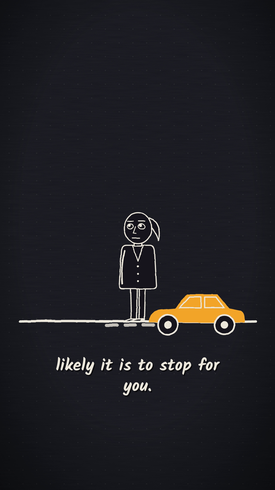
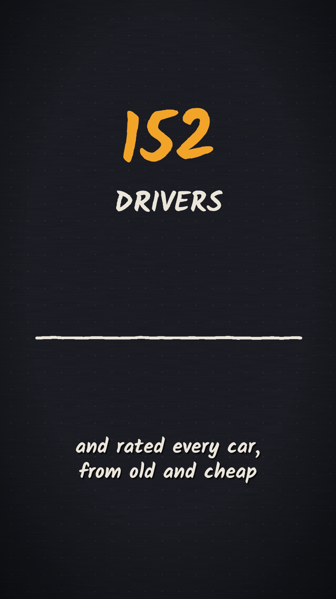
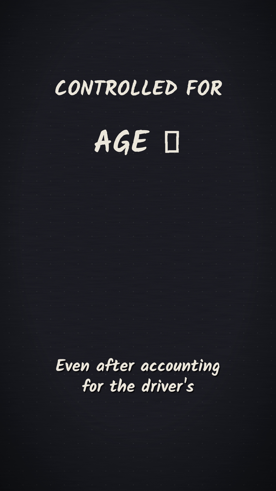
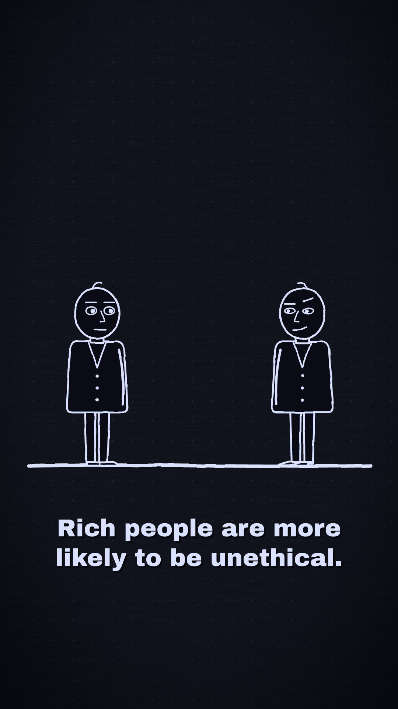
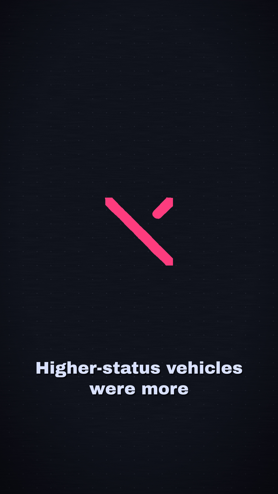
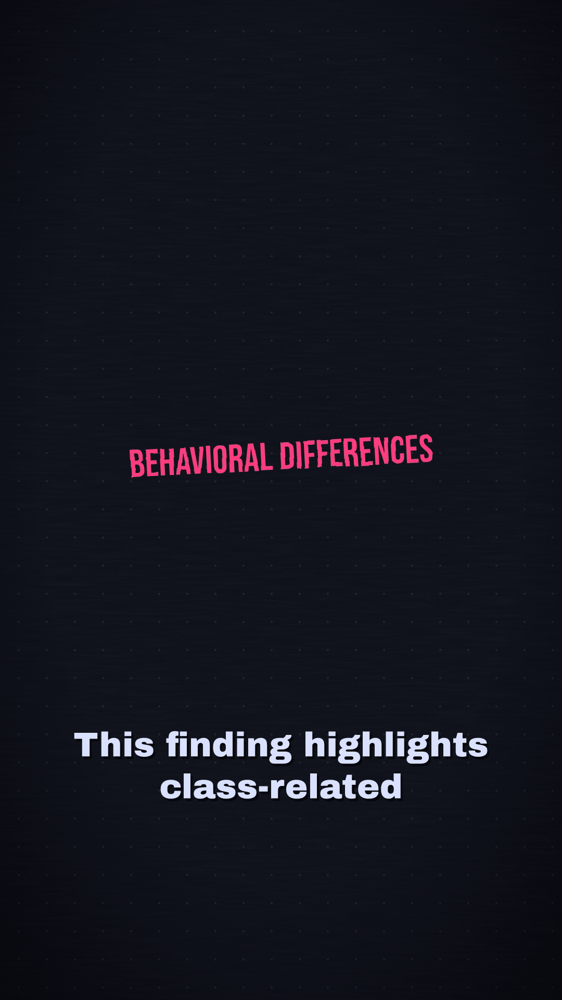
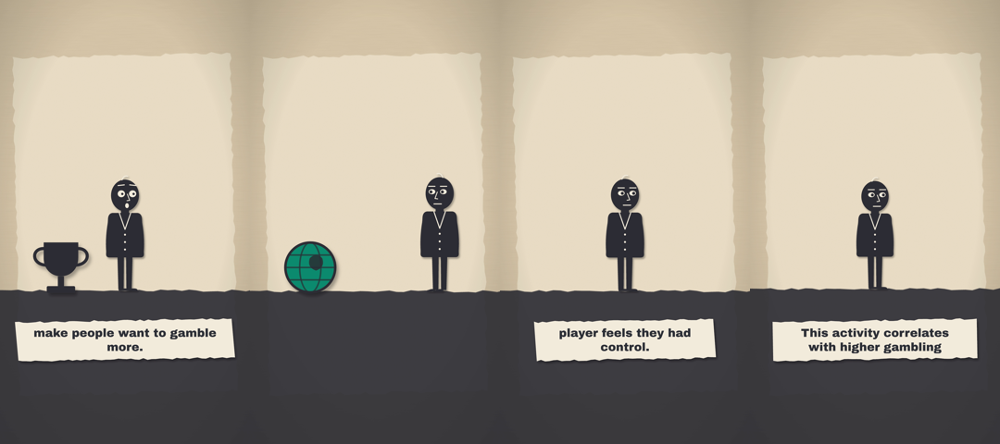
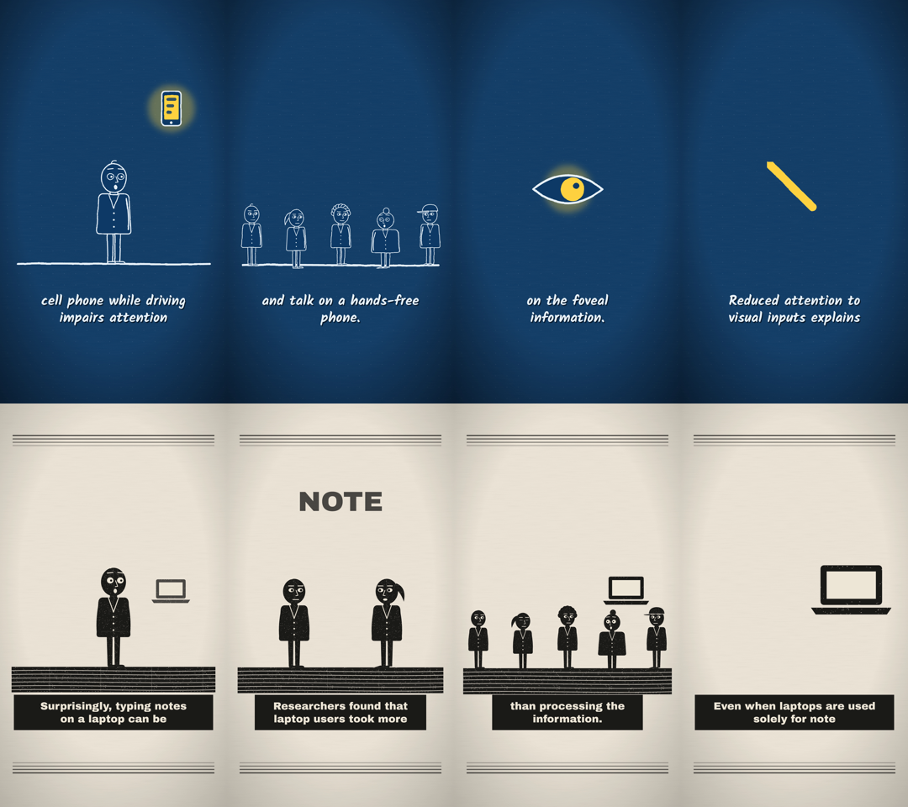
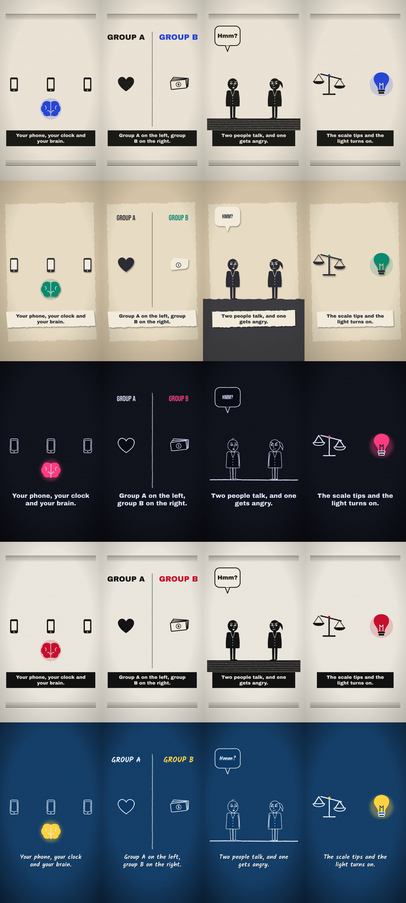

# ytfactory — Otomatik Animasyonlu Video Fabrikası

Psikoloji ve davranış bilimi konulu **YouTube Shorts ve uzun videoları** senaryodan bitmiş MP4'e kadar otomatik üreten hat. Tek senaryo dosyasından seslendirme, kelime kelime zamanlama, çizim animasyonu ve render.

## Nasıl çalışır
1. **Senaryo** (`script.<dil>.json`): satırlar, ses, hız ve **zorunlu kaynaklar** (her olgu birincil kaynakta doğrulanır).
2. **Seslendirme** (`src/tts.py`): edge-tts ile tek geçişte seslendirir, **kelime zaman çizelgesini** çıkarır.
3. **Sahne** (`scenes.js`): animasyonlar süre oranıyla değil, *kelimeye* bağlanır (`L.wat(T, 'l3', 'kelime')`) → ses ve görüntü her zaman senkron.
4. **Render** (`src/render/render.js`): programatik SVG çizimi → kare kare görüntü → MP4. 6 görsel stil, dikey 1080×1920 ve yatay 1920×1080.

## Kanallar
| Kanal | Format | Dil | Stil |
|---|---|---|---|
| Mind After Dark | Shorts + uzun | EN | gece |
| Beyin Kesiti | Shorts | TR | kesik |
| The Status Engine | Uzun | EN | lino |

Kanal görselleri (banner, avatar) de kodla üretilir: `node channels/brand.js`.

## Örnek
`videos/004-crosswalk/` — tam senaryo, sahne dosyası ve render'dan örnek kareler.

<p>



</p>

## Ajan: kaynak metinden bitmiş videoya (lokal)
`src/ajan.py` bir kaynak metni (makale özeti, çalışmanın yöntem/bulgu notları) ve atıf bilgisini alır, insan eli değmeden videoyu üretir. Tamamen lokal çalışır (Ollama). Hiçbir yere yükleme yapmaz; yayın kararı insanındır.

```
kaynak.txt → [7B] senaryo → rakam kontrolü + [14B] olgu denetimi → [7B] sahne tarifi (JSON) → kelime bağı / stil doğrulaması
          → edge-tts + kelime zamanları → kontrol kareleri → MP4
```
- **Model kod yazmaz, tarif yazar.** Küçük bir model `scenes.js` gibi animasyon kodunu güvenilir yazamıyor. Ajan bunun yerine 9 öğelik sınırlı bir kelime dağarcığıyla (başlık, damga, kişi, sıra, sayaç, çarpı, balon…) bir sahne tarifi yazıyor. `src/render/spec.js` bu tarifi mevcut çizim kütüphanesiyle sahneye çeviriyor. Yerleşim ve zamanlama kodda, yani güvenli alan ve stil kuralları ihlal edilemiyor.
- **Her doğrulayıcı hatayı modele geri verir**, model en fazla 3 kez yeniden dener. Her adım `ajan_kaydi.json`'a yazılır.
- Örnek çıktı: [videos/900-ajan-test](videos/900-ajan-test): [video (neon stili)](videos/900-ajan-test/900-ajan-test_neon_en.mp4), senaryo, sahne tarifi, ajan kaydı. Üretim süresi ~12 dk (GTX 1650, 4 GB).

<p>



</p>

```bash
python src/ajan.py --slug 005-konu --kaynak kaynak.txt --atif "Yazar (Yıl). Başlık. Dergi." --stil neon
```

### Hata → düzeltme süreci (ilk test, 08.11)
Test kaynağı: Piff ve ark. (2012, PNAS) çalışmasının yöntem ve bulgu notları.
1. **Kelime bağı hatası.** Sahne tarifinde model animasyonu "were observed" gibi kelime gruplarına bağladı. Doğrulayıcı yakaladı ve hatayı geri verdi, ama model **3 denemede de düzeltmedi**, ajan durdu. Düzeltme: prompta her satırın izinli kelime listesini koydum. Buna ek olarak, grubun satırda geçen ilk kelimesini seçen deterministik bir onarım adımı yazdım. Onarımlar kayda geçiyor.
2. **Uydurma rakam.** Model %34,9'u "35" diye yuvarladı. Rakam kontrolü (senaryodaki her sayı kaynakta geçmeli) yakaladı, ikinci denemede düzeldi.
3. **Asıl tehlikeli hata: doğru rakam, yanlış anlam.** Model "lüks araçların %34,9'u yol vermedi" yazdı. Kaynakta %34,9 *tüm* sürücülerin oranı. Üstelik bunu başka bir çalışmanın %12,4'üyle karşılaştırdı. Rakamlar kaynakta geçtiği için rakam kontrolü bunu göremedi. Aynı 7B modeli olgu denetçisi yaptım, o da **göremedi**. Düzeltme: denetçiyi ayrı ve daha büyük bir model yaptım (qwen2.5:14b). 14B hatayı doğru gerekçeyle yakaladı ("bu oran alt grubun değil, tüm araçların"). Kaynakta olmayan bir genellemeyi de ("kamu güvenliğini artırır") işaretledi.

| | 7B kendi kendini denetliyor | 7B yazar + 14B denetçi |
|---|---|---|
| Uydurma rakam | yakalandı (kural) | yakalandı (kural) |
| Yanlış gruba atanmış oran | **geçti** | **yakalandı** |
| Kaynakta olmayan genelleme | geçti | yakalandı |

4. **Denetçinin yanlış alarmı.** 14B denetçi bir turda doğru bir cümleyi ("lüks araçlar daha az yol veriyor") yanlış diye işaretledi. Ajan cümleyi gereksiz yere yeniden yazdırdı. Zarar vermedi ama denetçinin de hata yaptığını gösteriyor.
5. **Doğrulayıcıları geçip karede çıkan hatalar.** İlk videonun kontrol karelerine bakınca üç hata buldum:
   - Ekranda kaynakta olmayan bir **%75** vardı. Kelime normalleştirme "34.9%"un noktasını silip "349" yapıyordu; model sayaç hedefine bunu yazmıştı. Düzeltme: sayaç hedefi satırda söylenen bir sayı olmak zorunda (doğrulayıcı kuralı), sayaç ondalık gösteriyor, prompttaki kelime listesi ondalığı koruyor.
   - Altyazı "34.9"daki noktayı cümle sonu sanıp ekrana tek başına "9%" yazdı. Düzeltme: iki rakam arasındaki noktada bölünmüyor.
   - Araba sırası kişinin kafasına bindi. Düzeltme: sahnede kişi varken sıra üst bölgeye yerleşiyor.

   Bu üçünü hiçbir otomatik kontrol yakalamadı; kontrol karelerine bakan insan yakaladı. "Kontrol kareleri" adımı bu yüzden var.

6. **Son videoda kalan sorunlar (düzeltilmedi, kayıtta duruyor):**
   - İlk satır "zenginler daha etik dışı davranıyor" diyor. Çalışma bunu yalnızca sürüş davranışında gösterdi; bu bir **aşırı genelleme** ve 14B denetçi bunu geçirdi.
   - Bazı sahnelerde ilk görsel, satırın ortasındaki bir kelimeye bağlı. O yüzden satır başında 1-2 saniye ekranda sadece altyazı kalıyor.
   - Uzun başlıklar ekrandan taşıyordu. Bu düzeltildi: başlık boyutu artık metin uzunluğuna göre küçülüyor.

**Ders:** Ajanın yazdığını aynı model denetleyince kendi hatasını görmüyor. Denetçi ayrı ve daha güçlü olmalı. Bu da yetmez: bu tek bir testti, denetçi her hatayı yakalayacak diye bir garanti yok. O yüzden yayından önce insan kontrolü zorunlu kalıyor.

### Üç farklı alanda test (08.11)
Kaynaklar PubMed'den çekilen özetler, ajana sadece özet metni verildi:
| Video | Kaynak | Stil | Sonuç |
|---|---|---|---|
| 910 Neredeyse kazanmak (oyun psikolojisi) | Clark ve ark. 2009, *Neuron* | kesik | 4. denemede üretildi (27 dk): Ollama 500, sayılmayan satıra sayaç, zaman aşımı ve denetçinin aşırı katılığı tek tek çözüldü |
| 911 Telefonla konuşurken sürüş | Strayer ve ark. 2003, *J Exp Psychol Appl* | plan | Üretildi. Denetçi "görüşü bozar" ifadesini yakaladı ("dikkati" olmalı) |
| 912 El yazısı ve laptop | Mueller ve Oppenheimer 2014, *Psychol Sci* | lino | Üretildi. 3 otomatik onarım (uydurma nesne "note" → başlık) |

**Bu turda bulunan hatalar ve düzeltmeler:**
- **Ollama 500:** 7B ve 14B 4 GB GPU'da sırayla yüklenirken bellek yetmiyor. Ajanın tekrar deneme mantığı yoktu. Düzeltme: artan bekleme süresiyle 4 deneme.
- **Uydurma nesneler:** Model "billboard", "laptop", "pen", "slot", "note" gibi kütüphanede olmayan nesneler istedi ve 3 geri bildirime rağmen ısrar etti. Düzeltme: sık istenenleri (laptop, kalem, göz) kütüphaneye çizdim. Geri kalanlar için deterministik onarım: bilinmeyen nesne o kelimeyi ekrana yazan bir başlığa dönüşüyor, anlam kaybolmuyor.
- **Sayılmayan satırda sayaç:** Onarım kuralı eklendi; söylenen sayı yoksa sayaç çıkarılıyor.
- **Denetçinin kaçırdıkları (düzeltilmedi, kayıtta):**
  - 911'de "öndeki araçların fren lambalarını fark etmediler" deniyor. Kaynak "frenleyen araçlara tepkileri bozuldu" diyor, "fark etmediler" demiyor.
  - 912'de "testlerde daha kötü" deniyor. Kaynak "kavramsal sorularda" diyor.
  - 912'de "hatırlamayı bozar" iddiası özette yok.

  Üç videonun üçünde de denetçi en az bir aşırı genellemeyi geçirdi. **Ajan, insan kontrolü olmadan yayın yapabilecek seviyede değil.**
- **Zaman aşımı:** Tekrar deneme mantığı sadece HTTP hatalarını yakalıyordu, zaman aşımını yakalamıyordu. Kapsamı genişletildi.
- **Denetçi bu sefer fazla katı:** 910'da "ödül devreleri neredeyse kazanmayı motive edici kılıyor" cümlesini reddetti. Oysa kaynak tam olarak bunu söylüyor. Yani denetçi bir videoda aşırı genellemeyi kaçırıyor, diğerinde doğru cümleyi reddediyor; tutarsız. Son çare kuralı eklendi: son denemede hâlâ işaretli satırlar varsa, en az 5 satır kalmak şartıyla çıkarılıyor. Şüpheli cümleyi tutmaktansa atmak daha güvenli.
- **Donanım darboğazı:** 910'da Ollama 6 kez 500 verdi. 4 GB GPU'da 7B ile 14B arasında geçiş bir videoyu 12 dakikadan 27 dakikaya çıkardı. Bunun çözümü ayrı bir ölçüm çalışmasının konusu (quantization, offloading).
- **Görsel kalite kontrolü yok:** Doğrulayıcılar kural ihlallerini yakalıyor, ama görselin anlamlı olup olmadığını kontrol etmiyor. 910'da "slot makinesi" sahnesine dünya ikonu kondu, 4 sahnenin 4'ünde de aynı tek kişi var. Sıradaki iyileştirme: kontrol karelerine bakan bir görsel model ya da en azından "aynı öğe tipi üst üste kullanılamaz" kuralının kodda zorlanması.

<br>


- **Kaynağın kendisi:** Mueller ve Oppenheimer (2014) çalışmasının sonraki tekrarlarında sonuçlar tutarsız çıktı ve PubMed kaydında bir düzeltme notu var. Ajan sadece özeti gördüğü için bunu bilemez. Hangi kaynağın kullanılacağına insan karar vermeli.

## Ajanın çizim dağarcığı
İlk sürümde ajanın elinde 9 öğe vardı: kişi, araba, para, ev, kitap, hediye, sayaç, çarpı ve balon. Trafik çalışmasını anlatmaya yetiyordu, ama uyku, dikkat ya da para gibi konularda ajan doğru görseli bulamayıp her şeyi yazıyla geçiştiriyordu. Şu an 14 sahne öğesi ve 20 nesne var:
- **Sahne öğeleri:** başlık, damga, etiket, kişi, yürüyen kişi, sıra, sayaç, çarpı, balon, **ikon, grafik (yükselen / düşen / çubuk), ikiye bölünmüş karşılaştırma ekranı, karşılıklı iki kişi, kalabalık**
- **Nesneler:** araba, para, ev, kitap, hediye, **telefon, saat, beyin, kalp, ampul, kilit, kupa, terazi, dünya, banknot, hap, yatak, laptop, kalem, göz**

Yeni nesneler (`src/render/props.js`) yalnızca stilin boya rollerini kullanıyor. Bu yüzden 6 stilin hepsinde ayrı bir ayar gerekmeden doğru görünüyor:



## Stiller
`src/render/styles.js` stil sözleşmesi. Sahne kodu renk ya da font seçmez, sadece stile sorar. Çizim modları üç tane (`line` tebeşir, `fill` linol baskı, `cut` kesik kâğıt). Altı palet var: `gece`, `lino`, `kesik`, ve ajanla eklenen `neon` (karanlık psikoloji), `gazete` (siyaset), `plan` (teknik çizim).

## Teknoloji
Python · Ollama (qwen2.5 7B + 14B, lokal) · Node.js · resvg-js (SVG → PNG) · Python · edge-tts · ffmpeg

## Çalıştırma
```bash
npm install
python src/tts.py videos/004-crosswalk/script.en.json
node src/render/render.js videos/004-crosswalk gece en video
```

---
Geliştiren: **Emirhan Karaca**
